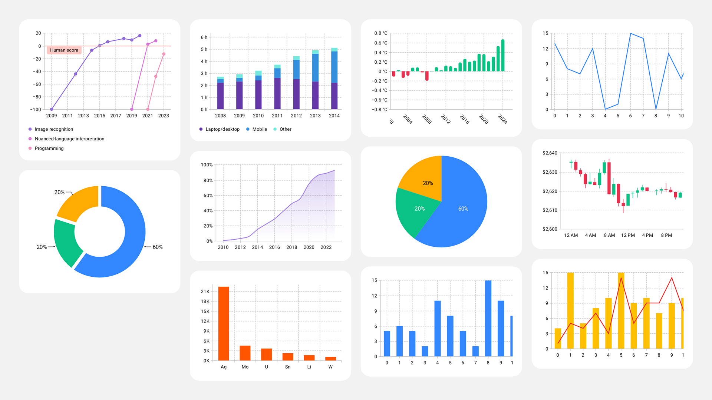

# Vico




Vico is a powerful and extensible chart library for Compose Multiplatform.

Learn more in [the guide](https://guide.vico.patrykandpatrick.com).

## Sponsored by [Software Mansion](https://swmansion.com)

Founded in 2012, [Software Mansion](https://swmansion.com) is a software agency
with experience in building web and mobile apps. We are core React Native
contributors and experts in dealing with all kinds of React Native issues. We
can help you build your next dream
product—[hire us](https://swmansion.com/contact/projects?utm_source=vico&utm_medium=readme).

[](https://swmansion.com)

## About this fork

This is Greater Goods' fork of [patrykandpatrick/vico](https://github.com/patrykandpatrick/vico),
used for the charts in meApp (Weight Gurus) Android.

- **Where our changes live:** the release branches (`version-3.0.0`, `version-4.0.0`, `5.0.2`),
  not `master`. `master` tracks upstream.
- **Publishing:** upstream folded `core` into `compose` at `v3.3.1`, so the `5.0.x` line publishes a
  single artifact — `com.dmdbrands.lib:compose-android`, from `:vico:compose`, the only module with
  a publishing block:

  ```bash
  ./gradlew :vico:compose:publishAllPublicationsToGitHubPackagesRepository
  ```

  Bump `Versions.VICO` in `buildSrc` first. Credentials are `gpr.user` / `gpr.token` in
  `gradle-local.properties` (gitignored), and need a classic token with `write:packages`; values
  there take precedence over `-P` flags and environment variables. meApp reads the artifact from
  `https://maven.pkg.github.com/gg-engineering/vico`. The upstream `release-update.yml` workflow
  runs only in the upstream repository and does not publish this fork.
- **Upstream sync:** branch from the upstream release tag, re-apply our changes by hand per file,
  bump the version and publish. The `v3.3.1` migration is written up in `docs/migration-v3.3.1/`.

## Git hooks setup

Run once after cloning to enable the secret-scan and commit-message hooks:

```bash
git config core.hooksPath .githooks
```

## Quality checks

CircleCI (`.circleci/config.yml`) runs `build`, `test`, `check-formatting` and `scan` (the same
names as the GitHub Actions checks), plus `lint` and `coverage`. Run them locally with JDK 17:

```bash
# Lint: detekt + Android lint on vico/compose (warnings fail the build)
./gradlew :vico:compose:detekt :vico:compose:lintAndroidMain

# Unit tests, then the coverage report (vico/compose/build/reports/kover) and the 80 % gate
./gradlew test
./gradlew :vico:compose:koverHtmlReportAndroid :vico:compose:koverLogAndroid :vico:compose:koverVerifyAndroid

# Formatting (ktfmt 0.64, the version the check-formatting job uses)
java -jar ktfmt-0.64-with-dependencies.jar --dry-run --google-style --set-exit-if-changed .
```

**Coverage scope:** `vico/compose` as compiled for Android (`commonMain` + `androidMain`), which is
what meApp ships as `com.dmdbrands.lib:compose-android`. Left out, because meApp does not use them:
`vico/compose-m2`, `vico/compose-m3`, `vico/compose-glance`, the iOS / desktop / web source sets of
`vico/compose`, and the `sample` apps. Inside the scope, the Compose compiler's generated
`ComposableSingletons` classes are excluded (generated code).

The chart-flow tests live in `vico/compose/src/androidHostTest`. They draw a real
`CartesianChartHost` or `PieChartHost` with Robolectric (native graphics) and the Compose UI test
rule, push data through the model producer and check what was drawn. `ChartTestHarness.kt` holds the
recorders they share.

**detekt rules turned off**, because satisfying them means restructuring upstream Vico code or
changing its public API, which this fork avoids so upstream merges stay cheap:

| Rule | Why it is off |
|---|---|
| `LongParameterList` | Public constructors and `remember*` functions take every option as a parameter; changing them breaks the API meApp calls. |
| `TooManyFunctions`, `LargeClass` | Flag public API classes (`CartesianChart`, the axes, the layers). Splitting them changes the API. |
| `LongMethod`, `CyclomaticComplexMethod`, `ComplexCondition`, `NestedBlockDepth`, `ReturnCount`, `LoopWithTooManyJumpStatements` | Flag upstream drawing and label-placement algorithms. Splitting them is a behaviour risk with no test benefit, and every split is a merge conflict on the next upstream sync. |

Also configured: `MagicNumber` ignores annotation arguments and `FunctionNaming` ignores
`@Composable` functions (the standard Compose setup). Android lint disables only
`ObsoleteLintCustomCheck`: the `lint.jar` inside `androidx.lifecycle` targets an older lint API, so
lint skips it and warns about the library, not about this code.
